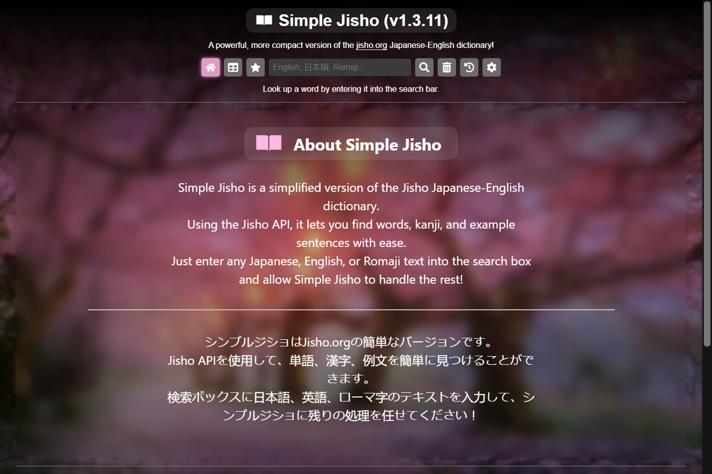
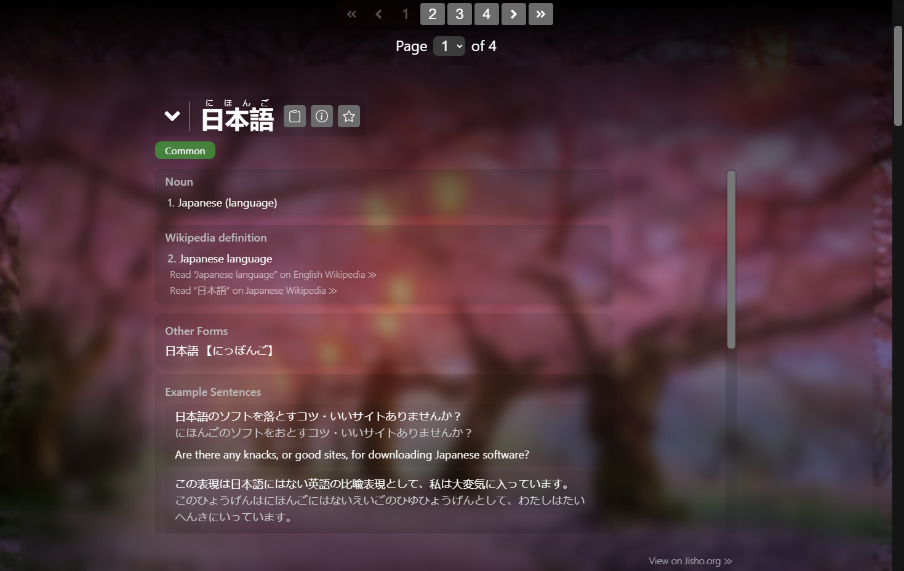
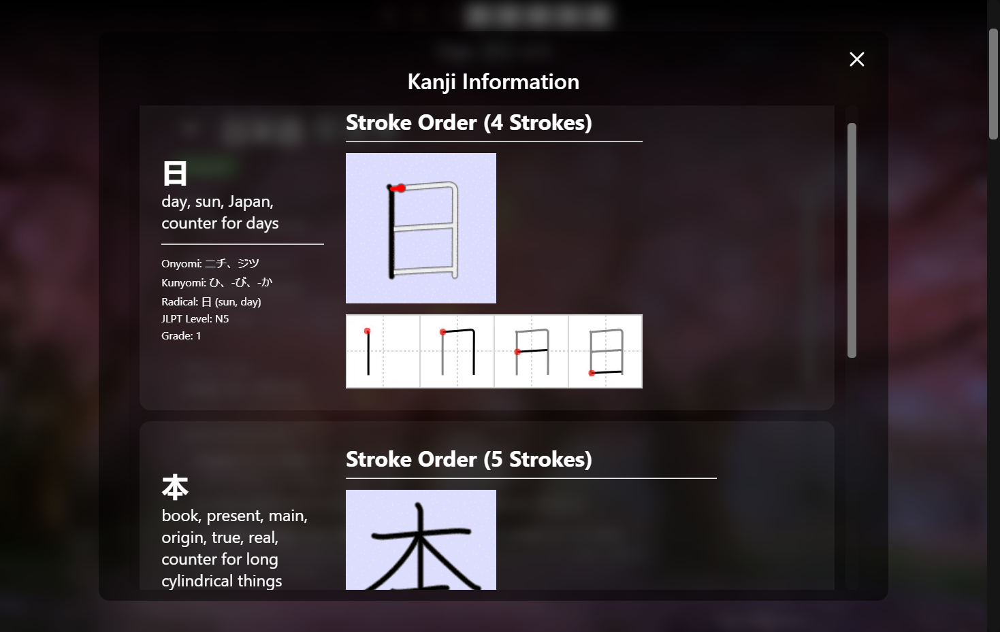
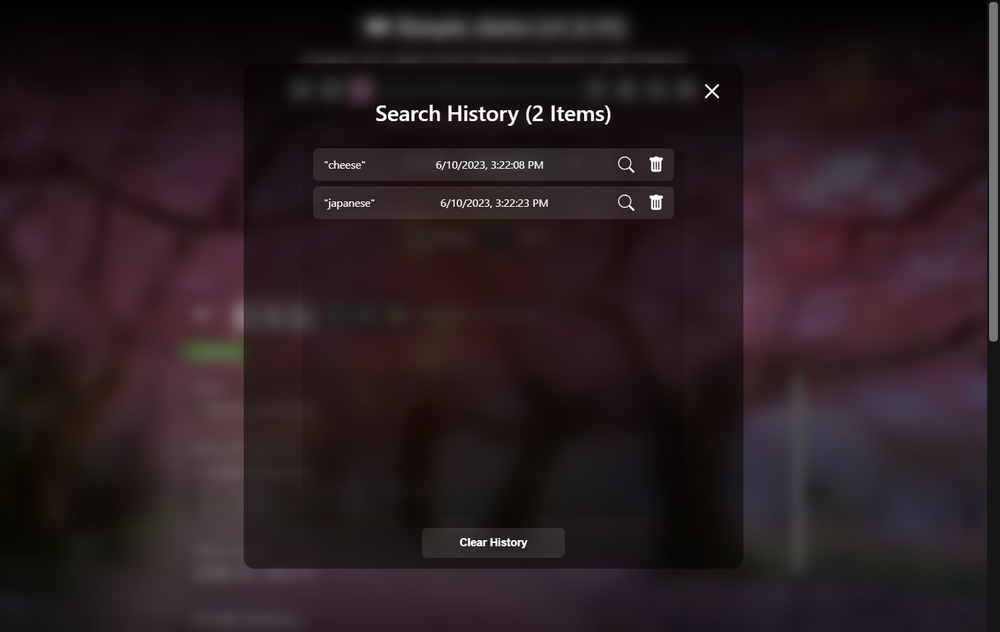
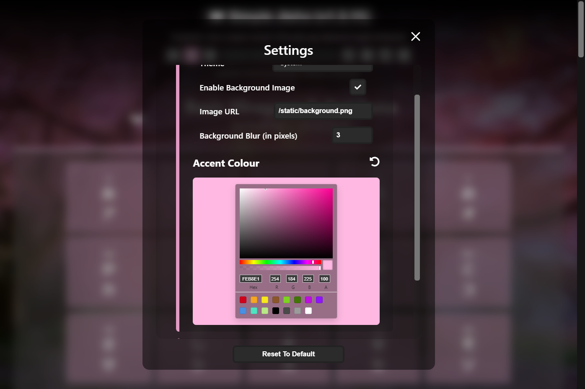

# **Simple Jisho**📕
## Description
Simple Jisho is a simple, condensed, and easy-to-use Japanese-English dictionary powered by the Jisho API.

Built with Next.js, SCSS, and TypeScript. Hosted on Netlify.

## Features
- Search for words in Japanese, English, or Romaji
  - View meanings, parts of speech, and example sentences
  - Look up detailed information on a word's kanji
  - View on- and kun- readings of kanji
- Review hiragana and katakana charts
  - View stroke order diagrams for kana and kanji
- View past searches (up to 20)
- Bookmark words for later
- Customize the colours and background of the app to your liking

## Previews (from v1.3.11)
<section align="center" id="front-page">
  <h1><b>Front Page</b></h1>
  
</section>

<section align="center" id="search">
  <h1><b>Search</b></h1>
  
</section>

<section align="center" id="kanji-info">
  <h1><b>Kanji Info</b></h1>
  
</section>

<section align="center" id="history">
  <h1><b>History</b></h1>
  
</section>

<section align="center" id="customization">
  <h1><b>Customization</b></h1>
  
</section>

## Credits
- [Jisho API](https://jisho.org/forum/54fefc1f6e73340b1f160000-is-there-any-kind-of-search-api)
- [Unofficial Jisho API](https://github.com/mistval/unofficial-jisho-api) (for added functionality)
- [Background Image](https://wall.alphacoders.com/big.php?i=937175)
